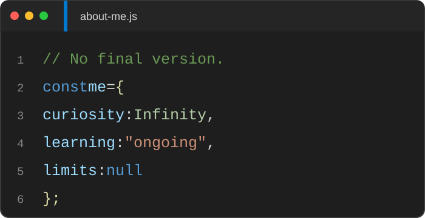
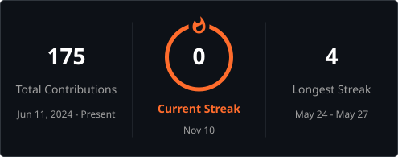

<!-- Full-width Banner -->

  

<h1 align="center">Hi, I'm Nayan Sharma</h1>

### About Me

<!-- VS Code-style intro panel + coding GIF -->

  
  

  <i>
    "Somewhere between curiosity and creation, 
    great things begin."
  </i>

---

### Tech Stack

  
    
  

---

### GitHub Stats

  
  
   
  <!--  -->
  

---

### Connect With Me

  
  &nbsp;&nbsp;&nbsp;
  
  &nbsp;&nbsp;&nbsp;
  

---

<i>“Fueled by code, caffeine, and curiosity”</i>

